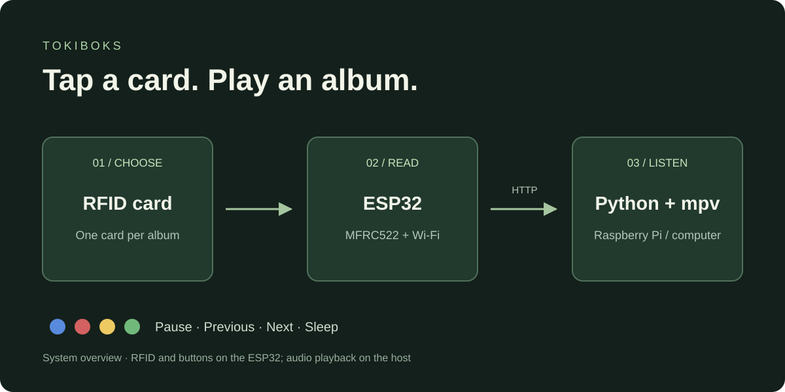

# tokiboks

A music player for toddlers, controlled by RFID cards and four colored buttons. Tap an album card to start listening; use the buttons to pause, skip tracks or set a sleep timer.



The ESP32 handles cards, buttons and the configuration web interface. A Raspberry Pi or another computer runs the audio player. Music paths are resolved on that player machine.

The system has three parts:

- **`firmware/`** — Arduino/ESP32 firmware
- **`player/`** — Python music player, runs on a Raspberry Pi (or any host machine)
- **`labels/`** — Tool for generating printable credit-card artwork for the RFID cards

## Get started

1. **Start the player.** Install Python 3.10+ and mpv, then run `python main.py` from [`player/`](player/). On Windows, the repository includes `mpv.exe`.
2. **Set up the ESP32.** Follow the [wiring](#hardware) and [firmware setup](#firmware) below, then flash the board.
3. **Connect the player.** Open the ESP32's web interface and set the player machine's IP address and port (`8000` by default).
4. **Map a card.** Open **Music Mapping**, tap a card, enter a music path or stream URL, save, and use **▶** to test it.
5. **Make the cards.** Use the [label generator](#labels) to prepare printable artwork for your albums.

For a look at the configuration interface without hardware, run `uv run dev_server.py` from the repository root and open `http://localhost:8080/`. This simulates the ESP32 API; playback still requires a running player.

[Hardware](#hardware) · [Firmware](#firmware) · [Player](#player) · [Labels](#labels) · [Troubleshooting](#troubleshooting) · [Development](#development)

---

## Hardware

- ESP32 development board
- MFRC522 RFID reader (SPI)
- 4 push buttons (blue, red, yellow, green)
- Raspberry Pi (or any machine that can run Python and mpv)

### ESP32 wiring

| MFRC522 | ESP32 |
|---------|-------|
| SDA/SS  | 15    |
| SCK     | 14    |
| MOSI    | 13    |
| MISO    | 26    |
| RST     | 27    |
| 3.3V    | 3.3V  |
| GND     | GND   |

| Button | GPIO |
|--------|------|
| Blue   | 4    |
| Yellow | 2    |
| Red    | 16   |
| Green  | 22   |

Buttons are wired between GPIO and GND (INPUT_PULLUP, active low).

---

## Firmware

### Prerequisites

- [Arduino IDE 2.x](https://www.arduino.cc/en/software)
- ESP32 board support package (add `https://raw.githubusercontent.com/espressif/arduino-esp32/gh-pages/package_esp32_index.json` to board manager URLs)
- Libraries (install via Library Manager): `MFRC522`

### Setup

1. Copy `firmware/secrets.h.example` to `firmware/secrets.h`:

```
cp firmware/secrets.h.example firmware/secrets.h
```

2. Edit `firmware/secrets.h` with your WiFi credentials and player IP:

```cpp
#define WIFI_SSID     "your_ssid"
#define WIFI_PASSWORD "your_password"

#define DEFAULT_SERVER_HOST "192.168.x.x"   // IP of the machine running the player
#define DEFAULT_SERVER_PORT 8000
```

`DEFAULT_SERVER_HOST` and `DEFAULT_SERVER_PORT` are compile-time fallbacks. They can be overridden at runtime via the web UI without reflashing.

3. Open `firmware/firmware.ino` in Arduino IDE, select your ESP32 board and port, and flash.

### First boot

On first boot the firmware tries to connect to WiFi using the credentials from `secrets.h`. If the connection fails or no credentials are set, it starts an open access point named **`tokiboks`**.

Connect to the `tokiboks` network and open `http://192.168.4.1/` to reach the configuration web UI. Set your WiFi credentials and hit **Save**, then **Restart device**. The device will reboot and connect to your network.

### Web UI

Once connected, the device IP is printed to serial. Open it in a browser. The web UI has three tabs:

- **Credentials** — WiFi SSID/password and admin username/password
- **Music Player** — IP address and port of the machine running the player
- **Music Mapping** — maps RFID card UIDs to file paths or URLs. Tap a card while the mapping tab is open to auto-fill the next empty row.

#### Playing from the web UI

Every mapping row has a **▶** button that plays that row on the music player, so an entry can be tested without hunting for its card. It sends whatever is currently *typed* in the row, not what was last saved — handy for trying a path before committing it. **Stop playback** in the table header stops the player.

Both go through the ESP32 (`POST /api/play?path=…`, `POST /api/stop`), which forwards to the player and passes its answer back, so the toast distinguishes the failure modes: a path the player can't find reports *path not found*, an unreachable or stopped player reports *player unreachable*.

Paths are percent-encoded before being sent, so spaces and `&` in filenames work. A `%` in a label is left as-is, so labels that were already encoded by hand keep working.

---

## Player

The player runs on a Raspberry Pi, any Linux/macOS machine, or Windows.

### Linux / Raspberry Pi

#### Prerequisites

```bash
sudo apt install mpv        # Raspberry Pi / Debian
# or: brew install mpv      # macOS
```

### Running

```bash
cd player
python main.py
```

The player listens on port `8000` by default. When the ESP32 scans an RFID card it looks up the label in the web UI mapping and sends a `GET /play?path=<label>` request to the player.

### Feedback sounds

Every `/play` request answers with a short cue before the album starts, so a card tap is never met with silence:

| Cue | When | Response |
|-----|------|----------|
| `player/sounds/success.wav` | path exists, playback starting | `200` |
| `player/sounds/error.wav` | path missing on disk | `404` |
| `player/sounds/error.wav` | request without a path | `400` |

Local paths are checked with `Path.exists()` before mpv is asked to load them — relative paths resolve against the player's working directory. Remote URLs (`http://`, `https://`, `rtsp://`, `rtmp://`) are passed through unchecked, since verifying a stream is not free.

`GET /stop` stops playback and clears any pending sleep timer, since its fade would otherwise carry a reduced volume into whatever plays next.

Cues play through a **second mpv instance** so they don't interrupt the album, which means two processes share the audio device. That works on PulseAudio/PipeWire and on ALSA's `default` (dmix) device; if a setup grabs the card exclusively, the cue instance fails to start, the player logs `cue player unavailable` and carries on without cues.

Replace either file to change the sounds — any format mpv can read works, as long as the filename stays the same. Attribution for the bundled sounds is in `player/sounds/CREDITS.md`.

### Button actions

| Button | Action          |
|--------|-----------------|
| Blue   | Pause / resume  |
| Red    | Previous track  |
| Yellow | Next track      |
| Green  | Sleep timer     |

The current player starts a **one-minute** timer when Green is pressed, with a fade over the last 50 seconds. The interval is set in [`player/main.py`](player/main.py); its existing console message says 15 minutes, but the implemented interval is 60 seconds.

### Auto-start with systemd

Create `/etc/systemd/system/tokiboks-player.service`:

```ini
[Unit]
Description=tokiboks music player
After=network.target sound.target

[Service]
ExecStart=/usr/bin/python3 /home/pi/tokiboks/player/main.py
WorkingDirectory=/home/pi/tokiboks/player
Restart=on-failure
User=pi

[Install]
WantedBy=multi-user.target
```

Enable and start:

```bash
sudo systemctl enable --now tokiboks-player
```

### Windows

`mpv.exe` is already bundled in `player/`. Install [Python 3.10+](https://www.python.org/downloads/) and run from the `player/` directory so Windows can find the bundled binary:

```bat
cd player
python main.py
```

#### Auto-start with Task Scheduler

1. Open **Task Scheduler** and choose **Create Basic Task**
2. Set the trigger to **When the computer starts**
3. Action: **Start a program**
   - Program: `python`
   - Arguments: `main.py`
   - Start in: `C:\path\to\tokiboks\player`
4. Under **Conditions**, uncheck "Start the task only if the computer is on AC power" if running on a laptop

---

## Labels

Tool for generating printable credit-card-sized artwork for the RFID cards. Requires [uv](https://docs.astral.sh/uv/). Supply your own cover images:

```bash
cd labels
uv run --no-project --with Pillow create_card.py --front /path/to/cover.jpg --output-dir output --cutting-guide --rfid black
```

Use `--back /path/to/back.jpg` for a reverse side, `--color-bottom` for a strip of dominant cover colors, or `--help` for all options. The default output is a portrait card at 1080 × 1712 pixels, matching a 54 × 85.6 mm card ratio.

---

## Troubleshooting

### Can't reach the web UI after a reboot

Check the IP printed on serial: your router may have assigned a different address. Confirm the browser is on the same network as the ESP32. If the device is in fallback access-point mode, connect to **tokiboks** and use `http://192.168.4.1/`.

### A card is detected, but nothing plays

Check the player IP and port in **Music Player**, then test the mapping with **▶**. A local path must exist on the player computer, not the ESP32; a relative path is resolved from the player's working directory. Keep the player and ESP32 on the same local network. The player listens on port 8000 on all interfaces and does not implement authentication.

---

## Development

### Web UI

The web UI (HTML/CSS/JS) lives in `firmware/data/`. After editing those files, regenerate the embedded C header:

```bash
python tools/web_to_header.py
```

To develop the web UI without flashing:

```bash
uv run dev_server.py
```

This starts a local server at `http://localhost:8080/` that mirrors the ESP32 API using the same JSON files. Simulate an RFID scan with:

```
http://localhost:8080/test-rfid?uid=ABCD1234
```

The dev server also mirrors `/api/play` and `/api/stop`, forwarding them to whatever player is configured in the **Music Player** tab. The **▶** and **Stop playback** buttons therefore work against a real player without flashing anything.
